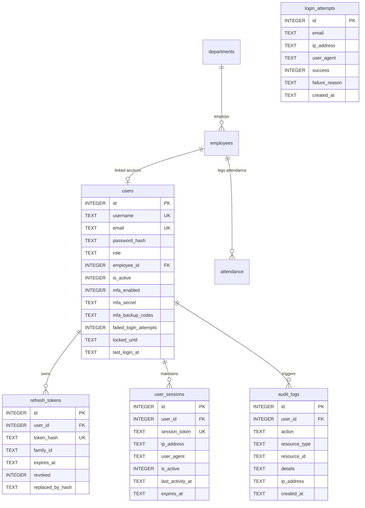

# Workforce Analytics Platform (WFA)
## Authentication, Authorization & Role-Based Access Control (RBAC) Module

An enterprise-grade, full-stack Workforce Analytics Platform with hardened SQLite-backed authentication, granular Role-Based Access Control (RBAC), multi-factor authentication (TOTP MFA), refresh token rotation, account lockout defense, audit logging, and role-adaptive dashboards.

Built with **React 19**, **TypeScript**, **Material UI**, **Recharts**, **Express**, and **SQLite** using the Repository Pattern.

## Technical documentation

- [System architecture](docs/ARCHITECTURE.md) — layers, responsibilities, and data flow.
- [Database architecture](docs/DATABASE.md) — SQLite schema, relationships, and constraints.
- [REST API reference](docs/API.md) — endpoints, permissions, and response formats.
- [Backend setup and security controls](backend/README.md) — configuration, database setup, and security behavior.
- [Demonstration guide](docs/DEMO-GUIDE.md) — local startup and a guided product walkthrough.
- [Screenshot evidence guide](docs/screenshots/README.md) — captured views and instructions for saving local PNG files.

---

## 1. Project Overview & RBAC Core Requirements

The **Workforce Analytics Platform (WFA)** delivers secure, role-differentiated workforce intelligence for executives, HR specialists, departmental managers, team leads, and employees.

### Key Authentication & Authorization Capabilities
- **Enterprise Authentication**: Secure credential verification, bcrypt password hashing (salt rounds = 12), short-lived JWT access tokens (15-minute expiry), and server-side session validation.
- **Refresh Token Rotation & Reuse Attack Detection**: Long-lived refresh tokens (7 days) are stored as hashes and rotated within token families. Reuse of a revoked refresh token revokes its family and the user's active sessions.
- **Multi-Factor Authentication (MFA)**: TOTP authenticator app support (Google Authenticator, Microsoft Authenticator, 1Password) with dynamic QR code generation and one-time emergency backup codes.
- **Account Lockout & Brute-Force Defense**: 5 consecutive failed login attempts trigger an automatic 15-minute lockout with HTTP 423 feedback and remaining-time counters.
- **API Rate Limiting**: Intelligent multi-tiered throttling (5 req/min on login, 10 req/min on sensitive operations, 120 req/min on general API routes).
- **Persistent Security Audit Logging**: Traceability for authentication events, login failures, lockout events, MFA lifecycle events, role changes, and administrative actions.
- **Live Session Management**: Session tracking with active device/IP attribution and real-time remote session revocation.
- **Role-Based Access Control (RBAC)**: 5 distinct organizational roles with strict server-side middleware authorization and tailored frontend UI navigation.

---

## 2. Role-Based Permissions Matrix

| Permission Capability | Admin | HR | Manager | Team Lead | Employee |
|---|:---:|:---:|:---:|:---:|:---:|
| **View Telemetry Dashboard** | ✅ | ✅ | ✅ | ✅ | ✅ |
| **View All Employees Directory** | ✅ | ✅ | ✅ | ❌ | ❌ |
| **View Department / Team Staff** | ✅ | ✅ | ✅ | ✅ | ❌ |
| **View Own Employee Profile** | ✅ | ✅ | ✅ | ✅ | ✅ |
| **Onboard New Employee** | ✅ | ✅ | ❌ | ❌ | ❌ |
| **Update Employee Record** | ✅ | ✅ | ❌ | ❌ | ❌ |
| **Delete Employee Record** | ✅ | ❌ | ❌ | ❌ | ❌ |
| **View All Attendance Records** | ✅ | ✅ | ✅ | ❌ | ❌ |
| **View Department Attendance** | ✅ | ✅ | ✅ | ✅ | ❌ |
| **View Own Attendance History** | ✅ | ✅ | ✅ | ✅ | ✅ |
| **Manage Attendance Records** | ✅ | ✅ | ❌ | ❌ | ❌ |
| **View Department Statistics** | ✅ | ✅ | ✅ | ✅ | ✅ |
| **Export Personnel Data (CSV)** | ✅ | ✅ | ❌ | ❌ | ❌ |
| **User Account Management** | ✅ | ❌ | ❌ | ❌ | ❌ |
| **Security Audit Logs Access** | ✅ | ❌ | ❌ | ❌ | ❌ |
| **Active Sessions Governance** | ✅ | ❌ | ❌ | ❌ | ❌ |
| **Personal Security Settings** | ✅ | ✅ | ✅ | ✅ | ✅ |

Managers can view employees, attendance, department distribution, and dashboard
data across all departments. Team Leads remain department-scoped because the
current data model does not define team membership. Employee records,
attendance, and dashboard aggregates are limited to the employee's linked
profile. API authorization is enforced independently of frontend navigation.

---

## 3. Seeded Accounts & Quick-Login Credentials

The system comes pre-seeded with 5 accounts covering each RBAC role for testing and evaluation. A one-click **Demo Role Switcher** is also embedded directly in the login portal and top navigation bar.

| Role | Email Address | Password | Assigned Persona & Permissions |
|---|---|---|---|
| 👑 **Admin** | `admin@workforce.com` | `Admin@123456` | System Administrator — Full access, User Management, Audit Logs, Sessions |
| 💼 **HR Specialist** | `hr@workforce.com` | `Hr@123456` | Amara Okafor (VP of Global Talent) — Directory, Onboarding, CSV Export |
| 📊 **Manager** | `manager@workforce.com` | `Manager@123456` | Marcus Chen (Director of Product) — Company-wide Employee Directory, Attendance & Analytics |
| 🚀 **Team Lead** | `lead@workforce.com` | `Lead@123456` | Zainab Al-Mansoor (Frontend Architect) — Team Presence & Directory |
| 👤 **Employee** | `employee@workforce.com` | `Employee@123456` | Sarah Jenkins (Staff ML Engineer) — Self Dashboard & Personal Attendance |

---

## 4. SQLite Database Architecture & Schema

The relational schema resides in `./data/workforce.db` with strict foreign key constraints (`PRAGMA foreign_keys = ON;`) and WAL journal mode.



---

## 5. REST API Reference

All REST endpoints return standardized response envelopes. Base URL: `http://localhost:3000/api`.

### Authentication & RBAC Routes (`/api/auth/*`)

| Method | Endpoint | Access Level | Description |
|---|---|---|---|
| `POST` | `/auth/login` | Public | Authenticates credentials; returns tokens or triggers MFA challenge |
| `POST` | `/auth/login/mfa` | Public | Validates TOTP code or backup code after MFA challenge |
| `POST` | `/auth/refresh` | Public | Rotates refresh token and issues new JWT access token |
| `POST` | `/auth/logout` | Authenticated | Revokes refresh token and terminates active session |
| `GET` | `/auth/me` | Authenticated | Retrieves current authenticated profile, role, and capabilities |
| `PUT` | `/auth/password` | Authenticated | Changes user password and revokes all active sessions |
| `POST` | `/auth/mfa/setup` | Authenticated | Generates TOTP secret and QR code data URL |
| `POST` | `/auth/mfa/verify` | Authenticated | Verifies authenticator code, activates MFA, and outputs backup codes |
| `POST` | `/auth/mfa/disable` | Authenticated | Disables MFA with password confirmation |
| `GET` | `/auth/users` | **Admin Only** | Paginated listing of all registered users and linked staff |
| `POST` | `/auth/users` | **Admin Only** | Registers a new user with an assigned RBAC role |
| `PUT` | `/auth/users/:id/role`| **Admin Only** | Modifies user's RBAC role and forces re-authentication |
| `PUT` | `/auth/users/:id/status`| **Admin Only** | Activates or deactivates an account (immediate session revocation) |
| `GET` | `/auth/audit-logs` | **Admin Only** | Paginated security audit log trail |
| `GET` | `/auth/sessions` | Authenticated | Lists active sessions (all for Admin, own for other roles) |
| `DELETE`| `/auth/sessions/:id` | Authenticated | Revokes and terminates a specific session |

### Core Business Routes (Protected by JWT & RBAC)

| Method | Endpoint | Authorization Rules | Description |
|---|---|---|---|
| `GET` | `/health` | Public | Health status and SQLite connectivity check |
| `GET` | `/dashboard/summary` | All Authenticated | Evaluates 5 primary KPI cards |
| `GET` | `/dashboard/attendance` | All Authenticated | Time-series presence trends |
| `GET` | `/dashboard/distribution`| All Authenticated | Departmental and employment status distribution |
| `GET` | `/departments` | All Authenticated | List departments |
| `GET` | `/employees` | Admin, HR, Manager, Team Lead | Paginated employee directory |
| `GET` | `/employees/export` | **Admin, HR Only** | Generates CSV export report |
| `GET` | `/employees/:id` | Authorized Roles | Fetches single employee record |
| `POST`| `/employees` | **Admin, HR Only** | Onboards a new employee (HTTP 201) |
| `PUT` | `/employees/:id` | **Admin, HR Only** | Modifies employee records |
| `DELETE`| `/employees/:id` | **Admin Only** | Deletes an employee record |
| `GET` | `/attendance` | Authorized Roles | Daily attendance records |

---

## 6. Installation & Execution Guide

### Step 1: Install Dependencies
```powershell
# Install root frontend dependencies
npm install

# Install backend dependencies (bcryptjs, jsonwebtoken, otplib, qrcode, express-rate-limit, uuid)
cd backend
npm install
cd ..
```

### Step 2: Seed SQLite Database
Initializes tables, creates indexes, and seeds sample departments, employees, attendance, and default RBAC accounts:
```powershell
npm run server:seed
```

### Step 3: Run the Application
Open two terminal windows:

**Terminal 1 — Backend REST API**:
```powershell
npm run server
```
*Backend runs on `http://localhost:3000/api`.*

**Terminal 2 — Frontend Application**:
```powershell
npm run dev
```
*Frontend runs on `http://localhost:5173`.*

---

## 7. Automated Test Execution & Results

Run the unit, integration, and frontend-to-backend end-to-end suites from the repository root:

```powershell
# Backend unit and integration tests, including authentication and security controls
npm run server:test

# Frontend unit tests and live frontend-service-to-backend end-to-end integration tests
npm test

# Build the frontend and backend
npm run build
npm run server:build

# Lint the project
npm run lint
```

### Most recent verification

- Backend: **84 tests passed, 0 failed**.
- Frontend and live API integration: **27 tests passed, 0 failed**.
- Browser smoke check: Admin login reached the dashboard and Admin-only account and audit pages; Employee login was denied access to `/audit-logs`.
- Frontend production build, backend TypeScript build, and lint: **passed**.

The browser smoke check is a manual UI demonstration, separate from the automated
service-level end-to-end integration tests.

---

## 8. Technology Stack

- **Frontend**: React 19, TypeScript, Material UI 9, Recharts 3, Vite 8
- **Backend**: Node.js, Express, TypeScript, better-sqlite3, Zod, Helmet, CORS
- **Security & Auth**: bcryptjs, jsonwebtoken, otplib (TOTP), qrcode, express-rate-limit, uuid
- **Storage**: SQLite 3 (WAL Mode, Foreign Key Enforcement, B-Tree Indexes)
- **Testing**: Node.js Built-in Test Runner (`node:test`), tsx, Supertest

---

**Workforce Analytics Platform (WFA)** • Stackly | Amalvia Group
*“Innovating today, securing tomorrow—your trusted partner in IT solutions.”*
