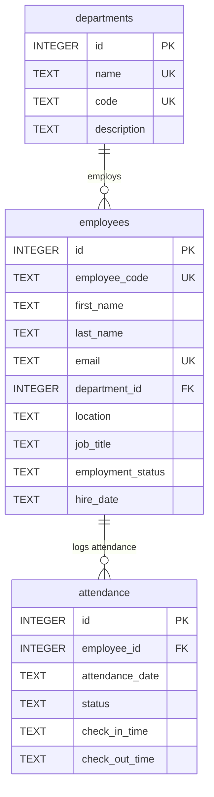

# Workforce Analytics Platform

An enterprise-grade, full-stack Workforce Analytics Platform providing SQLite-backed headcount metrics, attendance trends, organizational distribution, and server-side employee directory operations. Built with React, TypeScript, Material UI, Recharts, Express, and SQLite using the Repository Pattern.

---

## 1. Project Overview

The **Workforce Analytics Platform** provides HR leaders, department heads, and operations executives with an operational dashboard for monitoring staff headcount, recorded daily attendance statuses, business unit distributions, and employee directory records.

### Key Capabilities
- **Operational Headcount & Presence KPIs**: Real-time evaluation of total employee records across employment statuses, today's attendance rates, present/absent ratios, and approved leaves.
- **Attendance Trends**: Historical time-series analytics for recorded present, absent, and on-leave counts, with an attendance-rate view.
- **Organizational Distribution**: SQLite-backed employee headcount by department and current employment status.
- **Enterprise Employee Directory**: Server-side searching, multi-field filtering (department, location, status), bidirectional sorting, and fast pagination.
- **Live Employee Creation**: Add employee form persists supported employee fields to SQLite; contract type, promotion, and audit history are not modeled.

---

## 2. Features

| Feature Group | Implemented Functionality |
|---|---|
| **Five Primary KPI Cards** | Exactly 5 core metrics (**Total Employees**, **Present Today**, **Absent Today**, **Attendance Rate**, **On Leave**) computed directly via SQL aggregation from live attendance records. |
| **Attendance Analytics** | Stacked area chart for recorded present, absent, and on-leave counts, with a toggle to view attendance rate over the selected date range. |
| **Workforce Status Donut** | Donut chart rendering SQLite employment status counts across all employee records, including terminated employees. |
| **Department Distribution** | SQL-backed bar chart of employee headcount by department. Clicking a bar filters dashboard analytics to that department. |
| **Recent Hires** | Displays employee records ordered by their persisted hire date; it does not represent promotions, transfers, or a full audit log. |
| **Employee Directory Table** | Server-side paginated data table featuring 300ms debounced search (matching name, employee code, or email), multi-field dropdown filters, and column sorting. |
| **Multi-Dimensional Filters** | Dashboard filters for department, location, employment status, attendance date range (`7d`, `30d`, `90d`, `1y`), and employee search. Employee counts and distributions use the same search and workforce filters. Department and location options are loaded from API data. |
| **Responsive UI & Themes** | Cohesive slate-blue dark mode (`#0F172A`) and crisp off-white light mode (`#F8FAFC`). Fluid layouts for Desktop (5 KPI cols), Tablet (2+2+1 grid), and Mobile (stacked cards + slide-out drawer). |
| **Resilient State Indicators** | Skeleton loaders during fetch, empty state visual fallbacks with filter reset triggers, and connection error banners with manual retry buttons. |
| **Persistent SQLite Storage** | Fully persistent relational database (`better-sqlite3`) with foreign key enforcement, B-Tree indexes, and ACID guarantees. |

---

## 3. Technology Stack

### Frontend Client
- **Framework**: React 19 (`19.3.1`)
- **Language**: TypeScript (`~6.0.3` / `5.8`)
- **Tooling & Bundler**: Vite 8 (`8.3.4`)
- **UI & Design System**: Material UI (`@mui/material` 9.5.0, `@emotion/react` 11.14.0)
- **Data Visualization**: Recharts (`3.10.1`)
- **Typography**: Inter (Google Fonts) with tabular numeral support
- **Icons**: Material UI Outlined Icons (`@mui/icons-material` 9.5.0)

### Backend API Server
- **Runtime**: Node.js (LTS / v24)
- **Framework**: Express (`4.21.2`)
- **Language**: TypeScript (`5.8.2`)
- **Database**: SQLite 3 via `better-sqlite3` (`13.0.0`)
- **Schema Validation**: Zod (`3.24.2`)
- **Security & Headers**: Helmet (`8.0.0`), CORS (`2.8.5`)
- **Development & Test**: `tsx` (`4.19.3`), Supertest (`7.0.0`), Node Test Runner (`node:test`)

---

## 4. Architecture

The application adheres to a decoupled, layered architectural pattern. Neither controllers nor UI components contain raw database logic; all queries are encapsulated within dedicated repository classes.

### Request Flow
```
Browser / React UI
   │
   ▼
Frontend API Service Layer (`src/services/*`)
   │  (HTTP / JSON with in-memory caching & request deduplication)
   ▼
Express REST API Routes (`backend/src/routes/*`)
   │  (Helmet security headers, CORS origin whitelist, Zod schema validation)
   ▼
Controllers (`backend/src/controllers/*`)
   │  (Request parsing and HTTP response envelope serialization)
   ▼
Business Services (`backend/src/services/*`)
   │  (Domain logic, business rules, metric computations)
   ▼
Repositories (`backend/src/repositories/*`)
   │  (Parameterized SQL queries, transactions, column whitelisting)
   ▼
SQLite Relational Database (`./data/workforce.db`)
```

### Architectural Diagram
```mermaid
graph TD
    subgraph Frontend ["Frontend Client (Vite + React 19 + MUI)"]
        Dashboard[Dashboard Views & Visualizations]
        Table[Employee Directory Table]
        Filters[Dashboard Filter Bar]
        ClientService[API Service Layer (dashboard, employee, department)]
        HTTPClient[HttpClient (Fetch Wrapper + Caching)]
        Dashboard --> ClientService
        Table --> ClientService
        Filters --> ClientService
        ClientService --> HTTPClient
    end

    subgraph Backend ["Backend Service (Node.js + Express + Zod)"]
        Middleware[Helmet, CORS, Zod Validation]
        Routes[API Routes (/api/*)]
        Controllers[Controller Handlers]
        Services[Business Service Layer]
        HTTPClient -->|REST / JSON| Middleware
        Middleware --> Routes
        Routes --> Controllers
        Controllers --> Services
    end

    subgraph Data ["Data Layer (Repository Pattern + SQLite)"]
        Repos[Repositories (Dashboard, Employee, Dept, Attendance)]
        DB[(SQLite: workforce.db)]
        Services --> Repos
        Repos -->|Parameterized SQL| DB
    end
```

For comprehensive architectural specifications, refer to [docs/ARCHITECTURE.md](docs/ARCHITECTURE.md).

---

## 5. Prerequisites

- **Node.js**: Version `20.x` or `22.x+` (verified on Node.js v24)
- **npm**: Version `10.x+`
- **Operating System**: Windows, macOS, or Linux

---

## 6. Installation & Execution Guide

The repository contains the frontend client at the root and the backend server in the `backend/` directory.

### Step 1: Install Dependencies
```powershell
# Install root (frontend) dependencies
npm install

# Install backend dependencies
npm --prefix backend install
```

### Step 2: Configure Environment Variables
Copy the example environment files:
```powershell
# Frontend environment
cp .env.example .env

# Backend environment
cp backend/.env.example backend/.env
```

### Step 3: Initialize & Seed the SQLite Database
The seeding script creates the normalized tables, applies indexes, and seeds 30 employees, 6 departments, and 30 days of attendance:
```powershell
npm run server:seed
```

### Step 4: Start the Applications
Open two separate terminal windows:

**Terminal 1 — Start the Backend Server**:
```powershell
npm run server
```
*The REST API server will start on `http://localhost:3000/api`.*

**Terminal 2 — Start the Frontend Development Server**:
```powershell
npm run dev
```
*The Vite frontend will start on `http://localhost:5173`.*

---

## 7. Environment Configuration

### Frontend (`.env`)
```bash
# REST API Base URL
VITE_API_BASE_URL=http://localhost:3000/api

# Environment mode ('development' | 'production')
VITE_APP_ENV=development
```

### Backend (`backend/.env`)
```bash
# Server port
PORT=3000

# Server environment
NODE_ENV=development

# Allowed CORS origins
CORS_ORIGIN=http://localhost:5173

# SQLite database file path
DB_PATH=./data/workforce.db

# Logger level ('debug' | 'info' | 'warn' | 'error')
LOG_LEVEL=info
```

---

## 8. Database Architecture

The persistence tier consists of 3 relational tables with foreign keys and unique constraints:



- **Data Integrity**: Enforced via `PRAGMA foreign_keys = ON;`, `CHECK` constraints on valid statuses, and unique constraints on department names, employee codes, emails, and `(employee_id, attendance_date)`.
- **Indexes**: B-Tree indexes on `department_id`, `location`, `employment_status`, `employee_code`, `attendance_date`, and `status`.

For full DDL statements and migration details, see [docs/DATABASE.md](docs/DATABASE.md).

---

## 9. API Reference

All endpoints return uniform response envelopes. Base URL: `http://localhost:3000/api`.

| Method | Endpoint | Description | Key Query / Body Parameters |
|---|---|---|---|
| `GET` | `/health` | Server health and database check | None |
| `GET` | `/dashboard/summary` | Primary 5 KPI metrics | `date`, `department`, `location`, `status`, `search` |
| `GET` | `/dashboard/attendance` | Date-grouped presence trends | `startDate`, `endDate`, `department`, `location`, `status`, `search` |
| `GET` | `/dashboard/distribution`| Department & employment status distributions | `department`, `location`, `status`, `search` |
| `GET` | `/departments` | List all 6 departments | None |
| `GET` | `/departments/:id` | Fetch department by ID | `id` |
| `GET` | `/employees` | Paginated employee directory | `page`, `limit`, `search`, `department`, `location`, `status`, `sortBy`, `sortOrder` |
| `GET` | `/employees/locations` | Distinct locations stored for employees | None |
| `GET` | `/employees/:id` | Fetch single employee | `id` (numeric or `EMP-001`) |
| `POST`| `/employees` | Onboard new employee (HTTP 201) | `first_name`, `last_name`, `job_title`, `department`, `location`, `employment_status` |
| `GET` | `/attendance` | Paginated daily attendance logs | `page`, `limit`, `employeeId`, `date`, `status` |

### KPI Calculation Rules
- **Total Employees**: Count of all employee records matching department, location, status, and search filters. Without a status filter, this includes all employment statuses.
- **Present Today**: Count of active staff with status `'Present'` on target date.
- **Absent Today**: Count of active staff with status `'Absent'` on target date.
- **On Leave**: Count of active staff with status `'On Leave'` on target date.
- **Attendance Rate**: `(Present Today / Total Evaluated Records) * 100`. Returns `0%` if zero attendance records exist.

For representative request/response JSON payloads, see [docs/API.md](docs/API.md).

---

## 10. Automated Testing & Verification

The project includes unit, repository, service, integration, and E2E test suites with zero external test service dependencies.

### Run Tests
```powershell
# Run frontend client and live E2E integration tests (23 tests)
npm test

# Run backend unit, repository, and REST integration tests (59 tests)
npm run server:test

# Run ESLint across all TypeScript source files
npm run lint

# Compile frontend production bundle
npm run build

# Compile backend production bundle
npm run server:build
```

### Verification Results Summary
- **Backend Tests (`npm run server:test`)**: 59/59 passed
- **Frontend & Integration Tests (`npm test`)**: 23/23 passed (457ms)
- **Total Automated Tests**: **82 passed, 0 failed (100% pass rate)**
- **Static Analysis (`npm run lint`)**: 0 warnings, 0 errors
- **Production Build (`npm run build`)**: Vite built in 567ms (0 errors)
- **Backend Build (`npm run server:build`)**: TypeScript compiled cleanly (0 errors)

---

## 11. Known Limitations & Recommendations

1. **SQLite Concurrency**: SQLite operates in single-writer mode. For high-concurrency multi-tenant enterprise deployments, migrating repository classes to PostgreSQL is recommended. The Repository Pattern cleanly isolates all SQL access so that zero business services or UI controllers need modification.
2. **Offline Sandbox Browser Automation**: Automated headless browser testing (Playwright) is restricted in offline air-gapped sandboxes without pre-cached browser binaries. A comprehensive manual evaluator walkthrough is provided in [docs/DEMO-GUIDE.md](docs/DEMO-GUIDE.md).
3. **Chunk Size Notice**: Vite emits a standard chunk warning (>500 kB) caused by Recharts and Material UI icon packages. For production optimization, dynamic route-level imports (`React.lazy()`) can be introduced for the employee directory table.

---

## 12. Documentation Index

- [docs/FINAL-RELEASE-CHECKLIST.md](docs/FINAL-RELEASE-CHECKLIST.md) — 62-item release verification checklist.
- [docs/DEMO-GUIDE.md](docs/DEMO-GUIDE.md) — 5–10 minute live evaluator walkthrough and verification guide.
- [docs/ARCHITECTURE.md](docs/ARCHITECTURE.md) — Architectural overview, data flow, and design patterns.
- [docs/DATABASE.md](docs/DATABASE.md) — Relational schema DDL, ERD, indexes, and migration guidelines.
- [docs/API.md](docs/API.md) — REST API endpoint contracts and JSON envelopes.
- [docs/SPRINT-4-QA-PLAN.md](docs/SPRINT-4-QA-PLAN.md) — Sprint 4 QA audit, test matrices, and security review.
- [docs/SPRINT-3-INTEGRATION.md](docs/SPRINT-3-INTEGRATION.md) — Sprint 3 integration architecture.
- [docs/SPRINT-1-AUDIT.md](docs/SPRINT-1-AUDIT.md) — Sprint 1 frontend architectural audit.
