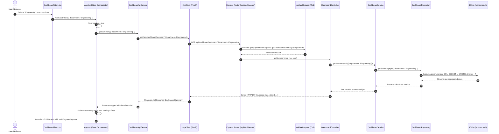
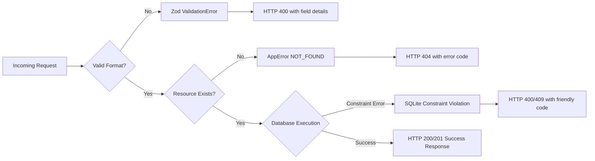

# Workforce Analytics Platform — System Architecture

This document provides a comprehensive technical overview of the **Workforce Analytics Platform**, detailing the system design, layer responsibilities, data flow, Repository Pattern implementation, state management, and error lifecycle.

---

## 1. High-Level System Architecture

The application is architected as a decoupled, full-stack enterprise web system:
- **Client Tier**: Single Page Application (SPA) built with React 19, TypeScript, Material UI (MUI v9), and Recharts v3, bundled with Vite 8.
- **Service Tier**: Node.js + Express REST API with Layered Architecture (Routes → Controllers → Services → Repositories).
- **Persistence Tier**: Embedded relational SQLite 3 database managed via `better-sqlite3` with strict foreign key constraints and B-Tree indexing.

```mermaid
graph TD
    subgraph Client Tier ["Client Tier (Browser SPA - React 19 + TypeScript)"]
        UI[Dashboard Views & Components]
        State[Filter & Data State Hooks]
        ClientService[Frontend API Service Layer]
        HTTPClient[HttpClient / Fetch Wrapper]
        UI --> State
        State --> ClientService
        ClientService --> HTTPClient
    end

    subgraph API Tier ["API Tier (Express REST Server - Node.js + TypeScript)"]
        MW[Security & Middleware (Helmet, CORS, Zod)]
        Routes[API Routes (/api/*)]
        Controllers[Controller Layer]
        Services[Business Service Layer]
        HTTPClient -->|HTTP / JSON| MW
        MW --> Routes
        Routes --> Controllers
        Controllers --> Services
    end

    subgraph Data Tier ["Data Tier (Repository Pattern & SQLite)"]
        Repos[Repository Layer]
        DB[(SQLite Relational Database)]
        Services --> Repos
        Repos -->|Parameterized SQL| DB
    end
```

---

## 2. Component & Folder Responsibilities

### 2.1. Frontend Directory Structure (`src/`)

```
src/
├── components/                 # Presentation and visualization components
│   ├── AttendanceTrendChart.tsx # Stacked Area chart with headcount/rate toggle & empty state
│   ├── DashboardFilters.tsx    # Multi-dimensional filter toolbar (Date, Dept, Loc, Status)
│   ├── DepartmentDistributionChart.tsx # Bar chart with headcount & eNPS toggles & click filter
│   ├── EmptyState.tsx          # Reusable zero-data graphic with action button
│   ├── ErrorState.tsx          # Reusable error alert with retry trigger
│   ├── KpiCard.tsx             # Metric card displaying values, trend deltas, and progress bars
│   ├── LoadingSkeleton.tsx     # Skeleton loaders matching dashboard layout
│   ├── RecentActivity.tsx      # Chronological employee event timeline with tabs
│   ├── Sidebar.tsx             # Collapsible primary navigation with drawer support
│   ├── Topbar.tsx              # Sticky header with search, theme switch, export, and state simulator
│   └── WorkforceDonutChart.tsx # Donut chart with contract status and center headcount
├── features/
│   └── employees/
│       └── EmployeeTable.tsx   # Server-side paginated, searchable, sortable directory table
├── services/                   # Centralized API service layer
│   ├── api/
│   │   ├── apiEndpoints.ts     # Centralized REST route constants
│   │   └── httpClient.ts       # Type-safe Fetch wrapper with error normalization
│   ├── attendance.service.ts   # Attendance records fetcher
│   ├── dashboard.service.ts    # Dashboard summary, trends, and distribution service
│   ├── departments.service.ts  # Department service with 60s in-memory caching & deduplication
│   └── employees.service.ts    # Employee directory query and creation service
├── theme/                      # Visual identity tokens and Material UI theme configuration
│   └── theme.ts                # Light/Dark palettes, custom elevation, typography tokens
├── types/                      # Shared frontend domain models and API contracts
│   ├── api.ts                  # Standard API envelope types (`ApiResponse`, `PaginatedResponse`)
│   └── index.ts                # Employee, Attendance, Department, and KPI data structures
├── App.tsx                     # Main dashboard coordinator, filter state, and modal orchestrator
└── main.tsx                    # React DOM root entry point
```

### 2.2. Backend Directory Structure (`backend/src/`)

```
backend/src/
├── config/
│   └── env.ts                  # Validated environment settings (PORT, NODE_ENV, CORS_ORIGIN, DB_PATH)
├── controllers/                # HTTP request/response handlers
│   ├── attendance.controller.ts
│   ├── dashboard.controller.ts
│   ├── department.controller.ts
│   ├── employee.controller.ts
│   └── health.controller.ts
├── database/                   # Persistence layer initialization
│   ├── connection.ts           # SQLite connection factory (`better-sqlite3`)
│   ├── schema.ts               # Relational DDL definitions and index creation
│   └── seed.ts                 # Idempotent database seeder (30 employees, 6 depts, 30 days)
├── middleware/                 # Cross-cutting middleware
│   ├── errorHandler.ts         # Centralized error handler masking internal paths in production
│   ├── notFoundHandler.ts      # 404 handler for unmatched routes
│   └── validateRequest.ts      # Generic Zod validation middleware for query, params, and body
├── repositories/               # Repository pattern: pure SQL execution
│   ├── attendance.repository.ts
│   ├── dashboard.repository.ts
│   ├── department.repository.ts
│   └── employee.repository.ts
├── routes/                     # Express router definitions
│   ├── attendance.routes.ts
│   ├── dashboard.routes.ts
│   ├── department.routes.ts
│   ├── employee.routes.ts
│   └── health.routes.ts
├── schemas/                    # Zod input validation schemas
│   ├── attendance.schema.ts
│   ├── dashboard.schema.ts
│   └── employee.schema.ts
├── services/                   # Business logic and domain computation
│   ├── attendance.service.ts
│   ├── dashboard.service.ts
│   ├── department.service.ts
│   └── employee.service.ts
├── types/                      # Backend TypeScript entity and domain definitions
├── utils/                      # Helper utilities
│   ├── date.ts                 # ISO date formatting and range utilities
│   └── response.ts             # Standard response formatting (`sendSuccess`, `sendError`)
├── app.ts                      # Express application assembly and middleware binding
└── server.ts                   # Process bootstrap and HTTP server listener
```

---

## 3. End-to-End Data Flow

The following sequence diagram details the end-to-end execution of a dashboard filter change (e.g., filtering by "Engineering"):



---

## 4. The Repository Pattern Implementation

The backend adheres strictly to the **Repository Pattern** to maintain high architectural separation between business rules and raw database access:

1. **Isolation of Persistence Details**: Neither Express controllers nor business services write SQL queries. All SQL statements, table joins, aggregations, and parameters reside solely inside the repository layer.
2. **Deterministic Testability**: Service layer tests can substitute mock repositories or test with an in-memory SQLite database (`:memory:`) without requiring a live file-based database or network server.
3. **Prepared Statement Optimization**: Repositories leverage `better-sqlite3` prepared statements (`db.prepare()`) which are pre-compiled by the SQLite engine, maximizing execution speed and preventing SQL injection vulnerabilities.
4. **Clean Migration Path**: If the system transitions from SQLite to PostgreSQL or MySQL, only the repository classes need modification. Zero changes are needed in controllers, route definitions, validation schemas, or frontend clients.

```mermaid
classDiagram
    class DashboardService {
        -dashboardRepo: IDashboardRepository
        +getSummaryKpis(filters)
        +getAttendanceTrends(filters)
        +getWorkforceDistribution()
    }

    class IDashboardRepository {
        <<interface>>
        +getSummaryKpis(filters)
        +getAttendanceTrends(filters)
        +getWorkforceDistribution()
    }

    class DashboardRepository {
        -db: Database
        +getSummaryKpis(filters)
        +getAttendanceTrends(filters)
        +getWorkforceDistribution()
    }

    DashboardService ..> IDashboardRepository : depends on
    DashboardRepository ..|> IDashboardRepository : implements
    DashboardRepository --> "better-sqlite3" : executes SQL
```

---

## 5. State Orchestration & Performance Strategies

### 5.1. Department Caching & Deduplication
To eliminate redundant HTTP requests when multiple components mount simultaneously:
- `DepartmentApiService` maintains a 60-second in-memory cache and inflight promise cache.
- Concurrent requests share the same pending Promise, ensuring exactly one network request occurs on initial page load.

### 5.2. Debounced Employee Search & AbortController Cancellation
- In `EmployeeTable.tsx`, keystrokes in the search input are debounced at 300ms.
- Any prior active search request is immediately cancelled using `AbortController.abort()`, preventing race conditions where slower, superseded search responses overwrite newer results.

### 5.3. Graceful Empty States & SVG Protection
- Recharts visualizations require valid non-empty arrays to compute SVG bounding boxes.
- `AttendanceTrendChart`, `DepartmentDistributionChart`, and `WorkforceDonutChart` feature dedicated empty-state guards that render a themed fallback card with guidance on how to adjust active filters.

---

## 6. Error Lifecycle & Security Design



- **Sensitive Data Masking**: In production mode (`NODE_ENV === 'production'`), error stack traces, database file paths, and internal error instances are stripped from the response body.
- **Security Headers**: Helmet injects headers protecting against clickjacking (`X-Frame-Options: SAMEORIGIN`), MIME sniffing (`X-Content-Type-Options: nosniff`), and cross-site scripting.
- **CORS Configuration**: Explicit origin whitelist matching the client Vite origin (`http://localhost:5173`).
