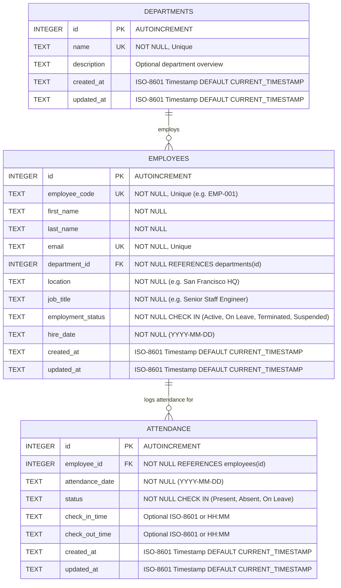

# Workforce Analytics Platform — Database Architecture & Schema

This document details the persistence layer of the **Workforce Analytics Platform**, including the relational schema, entity relationships, integrity constraints, indexes, idempotent seeding, and database initialization procedures.

---

## 1. Database Overview & Technology

- **Database Engine**: SQLite 3 via `better-sqlite3` (version 13.0).
- **Driver Type**: Embedded synchronous C++ binding for Node.js, providing high throughput, zero IPC network overhead, and ACID transaction guarantees.
- **Physical File Path**: `./data/workforce.db` (configurable via `DB_PATH` in `.env`).
- **Foreign Key Enforcement**: Explicitly activated upon every connection initialization via `PRAGMA foreign_keys = ON;`.
- **Journal Mode**: Default WAL (Write-Ahead Logging) recommended for high concurrent read operations.

---

## 2. Entity-Relationship Diagram (ERD)



---

## 3. Relational Schema Specifications

### 3.1. `departments` Table

Stores the organizational business units.

```sql
CREATE TABLE IF NOT EXISTS departments (
    id INTEGER PRIMARY KEY AUTOINCREMENT,
    name TEXT NOT NULL UNIQUE,
    description TEXT,
    created_at TEXT NOT NULL DEFAULT (strftime('%Y-%m-%dT%H:%M:%fZ', 'now')),
    updated_at TEXT NOT NULL DEFAULT (strftime('%Y-%m-%dT%H:%M:%fZ', 'now'))
);
```

| Column | Type | Constraints | Description |
|---|---|---|---|
| `id` | `INTEGER` | `PRIMARY KEY AUTOINCREMENT` | Unique numeric identifier |
| `name` | `TEXT` | `NOT NULL UNIQUE` | Human-readable name (e.g., "Engineering") |
| `description` | `TEXT` | `NULL` | Department mission and mandate |
| `created_at` | `TEXT` | `NOT NULL`, ISO-8601 default | Audit creation timestamp |
| `updated_at` | `TEXT` | `NOT NULL`, ISO-8601 default | Last update timestamp |

### 3.2. `employees` Table

Stores individual staff profiles, organizational placement, and employment status.

```sql
CREATE TABLE IF NOT EXISTS employees (
    id INTEGER PRIMARY KEY AUTOINCREMENT,
    employee_code TEXT NOT NULL UNIQUE,
    first_name TEXT NOT NULL,
    last_name TEXT NOT NULL,
    email TEXT NOT NULL UNIQUE,
    department_id INTEGER NOT NULL,
    location TEXT NOT NULL,
    job_title TEXT NOT NULL,
    employment_status TEXT NOT NULL
        CHECK (employment_status IN ('Active', 'On Leave', 'Terminated', 'Suspended')),
    hire_date TEXT NOT NULL,
    created_at TEXT NOT NULL DEFAULT (strftime('%Y-%m-%dT%H:%M:%fZ', 'now')),
    updated_at TEXT NOT NULL DEFAULT (strftime('%Y-%m-%dT%H:%M:%fZ', 'now')),
    FOREIGN KEY (department_id) REFERENCES departments(id) ON DELETE RESTRICT ON UPDATE CASCADE
);
```

| Column | Type | Constraints | Description |
|---|---|---|---|
| `id` | `INTEGER` | `PRIMARY KEY AUTOINCREMENT` | Unique numeric identifier |
| `employee_code` | `TEXT` | `NOT NULL UNIQUE` | Business identifier (e.g., "EMP-001") |
| `first_name` | `TEXT` | `NOT NULL` | Employee given name |
| `last_name` | `TEXT` | `NOT NULL` | Employee family name |
| `email` | `TEXT` | `NOT NULL UNIQUE` | Corporate email address |
| `department_id` | `INTEGER` | `NOT NULL, FK -> departments(id)` | Foreign key referencing department |
| `location` | `TEXT` | `NOT NULL` | Primary office location |
| `job_title` | `TEXT` | `NOT NULL` | Role designation |
| `employment_status`| `TEXT` | `NOT NULL`, `CHECK In ('Active','On Leave','Terminated','Suspended')` | Current employment status |
| `hire_date` | `TEXT` | `NOT NULL (YYYY-MM-DD)` | Date joined the company |
| `created_at` | `TEXT` | `NOT NULL`, ISO-8601 default | Audit creation timestamp |
| `updated_at` | `TEXT` | `NOT NULL`, ISO-8601 default | Last update timestamp |

### 3.3. `attendance` Table

Stores daily attendance status and optional check-in/out times.

```sql
CREATE TABLE IF NOT EXISTS attendance (
    id INTEGER PRIMARY KEY AUTOINCREMENT,
    employee_id INTEGER NOT NULL,
    attendance_date TEXT NOT NULL,
    status TEXT NOT NULL CHECK (status IN ('Present', 'Absent', 'On Leave')),
    check_in_time TEXT,
    check_out_time TEXT,
    created_at TEXT NOT NULL DEFAULT (strftime('%Y-%m-%dT%H:%M:%fZ', 'now')),
    updated_at TEXT NOT NULL DEFAULT (strftime('%Y-%m-%dT%H:%M:%fZ', 'now')),
    FOREIGN KEY (employee_id) REFERENCES employees(id) ON DELETE CASCADE ON UPDATE CASCADE,
    CONSTRAINT uq_employee_attendance_date UNIQUE (employee_id, attendance_date)
);
```

| Column | Type | Constraints | Description |
|---|---|---|---|
| `id` | `INTEGER` | `PRIMARY KEY AUTOINCREMENT` | Unique record identifier |
| `employee_id` | `INTEGER` | `NOT NULL, FK -> employees(id)` | Foreign key referencing employee |
| `attendance_date` | `DATE` | `NOT NULL (YYYY-MM-DD)` | Calendar date of attendance |
| `status` | `TEXT` | `CHECK In ('Present','Absent','On Leave')` | Daily presence status |
| `check_in_time` | `TEXT` | `NULL` | Recorded check-in timestamp |
| `check_out_time` | `TEXT` | `NULL` | Recorded check-out timestamp |
| `created_at` | `TEXT` | `NOT NULL`, ISO-8601 default | Audit timestamp |
| `updated_at` | `TEXT` | `NOT NULL`, ISO-8601 default | Last update timestamp |

---

## 4. Database Indexing & Performance Strategy

To ensure queries remain sub-millisecond even as employee and attendance tables scale into tens of thousands of rows, the following B-Tree indexes are automatically created during schema initialization:

```sql
-- Employee table search and filter indexes
CREATE INDEX IF NOT EXISTS idx_employees_department_id ON employees(department_id);
CREATE INDEX IF NOT EXISTS idx_employees_employment_status ON employees(employment_status);
CREATE INDEX IF NOT EXISTS idx_employees_location ON employees(location);
CREATE INDEX IF NOT EXISTS idx_employees_code ON employees(employee_code);
CREATE INDEX IF NOT EXISTS idx_employees_names ON employees(last_name, first_name);

-- Attendance aggregation indexes
CREATE INDEX IF NOT EXISTS idx_attendance_employee_id ON attendance(employee_id);
CREATE INDEX IF NOT EXISTS idx_attendance_date ON attendance(attendance_date);
CREATE INDEX IF NOT EXISTS idx_attendance_status ON attendance(status);
CREATE INDEX IF NOT EXISTS idx_attendance_date_status ON attendance(attendance_date, status);
```

### Query Execution Advantages
1. **Dashboard Summary Query**: Filters by `attendance_date` and groups by status; uses `idx_attendance_date` and `idx_attendance_status` to scan only today's records without touching the full historical attendance table.
2. **Attendance Trends Query**: Aggregates present, absent, and on-leave counts across date ranges using `idx_attendance_date`.
3. **Employee Directory Table**: Performs multi-field filtering on `department_id`, `location`, and `employment_status` supported by composite index coverage.

---

## 5. Seeding Procedure & Idempotency

The database seeder (`backend/src/database/seed.ts`) populates realistic enterprise test data:
- **6 Departments**: Customer Success, Engineering, Finance & Legal, Human Resources, Product & Design, Sales & Marketing.
- **30 Employees**: Diverse distribution across 4 locations (San Francisco HQ, London Tech Hub, Singapore Office, Remote Global) with Active, On Leave, and Terminated statuses.
- **30 Days of Attendance**: Historical records for non-terminated employees, including present, absent, and on-leave status counts.

### Idempotency Guarantee
The seeder runs inside an atomic transaction:
```ts
const insertEmployee = db.prepare(`
  INSERT INTO employees (...) VALUES (...)
  ON CONFLICT(employee_code) DO UPDATE SET
    first_name=excluded.first_name,
    last_name=excluded.last_name,
    job_title=excluded.job_title
`);
```
This ensures running `npm run server:seed` multiple times safely updates records without generating duplicate key collisions or bloating the database.

---

## 6. Migration Path: SQLite to PostgreSQL

The platform is designed around the **Repository Pattern** specifically to allow zero-downtime database engine migration. To migrate to an enterprise PostgreSQL cluster:

1. **Schema Equivalency**:
   - Change `INTEGER PRIMARY KEY AUTOINCREMENT` to `SERIAL PRIMARY KEY` (or `BIGINT GENERATED ALWAYS AS IDENTITY`).
   - Change `DATETIME DEFAULT CURRENT_TIMESTAMP` to `TIMESTAMPTZ DEFAULT NOW()`.
   - SQLite `DATE` and `TEXT` maps directly to PostgreSQL `DATE` and `VARCHAR`/`TEXT`.
2. **Repository Adapter**:
   - Replace `better-sqlite3` database driver in `database/connection.ts` with `pg` (`node-postgres`) connection pool.
   - Replace SQLite parameter placeholders `?` with positional PostgreSQL placeholders `$1, $2, ...`.
3. **Zero UI / Controller Changes**:
   - Because all controllers call repository methods via TypeScript interfaces (`IDashboardRepository`, `IEmployeeRepository`, etc.), zero modifications are required in services, controllers, or frontend React components.
