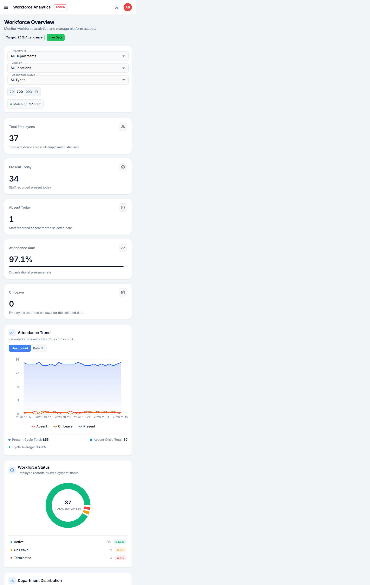
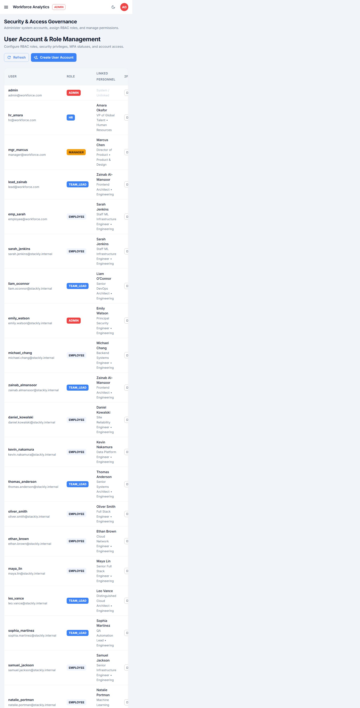
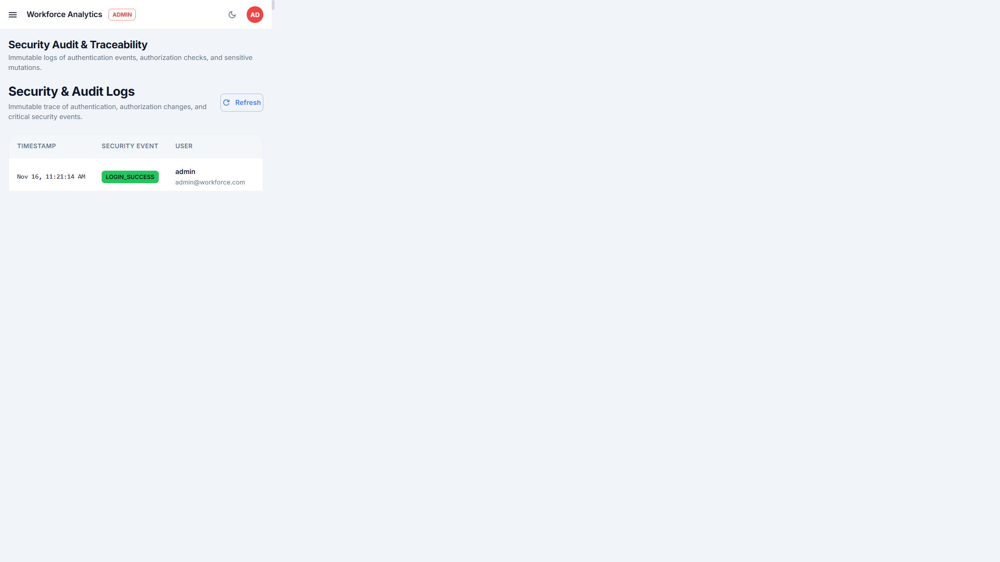
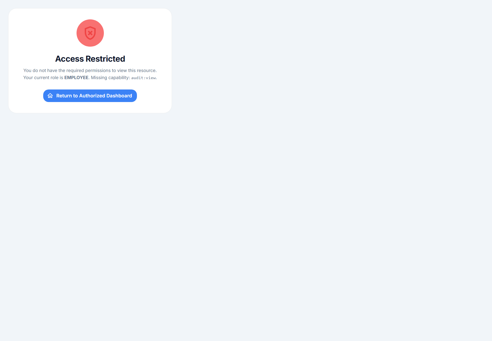

# Workforce Analytics Platform — Demonstration & Evaluator Guide

This document provides a structured, 5–10 minute demonstration sequence for evaluators, stakeholders, and reviewers testing the **Workforce Analytics Platform**.

---

## 1. Quick Launch Setup

Open two terminal windows in the project root (`c:\work\Workforce dashboard\Workforce`).
For a fresh local database, seed the development data once:

```powershell
npm run server:seed
```

Do not use the development seed accounts or data in production.

### Terminal 1: Start SQLite REST API Backend
```powershell
# Boots the backend on port 3000 (install dependencies first if needed)
npm run server
```
*Expected log output*:
```text
[INFO] SQLite Database initialized at ./data/workforce.db
[INFO] Server running in development mode on port 3000
[INFO] REST API available at http://localhost:3000/api
```

### Terminal 2: Start React Frontend
```powershell
# Launches Vite development server on port 5173
npm run dev
```
*Expected output*:
```text
  VITE v8.3.5  ready in 180 ms

  ➜  Local:   http://localhost:5173/
  ➜  Network: use --host to expose
```

Now open your web browser to: **`http://localhost:5173`**

---

## 2. Step-by-Step 5–10 Minute Demo Walkthrough

### Step 1: Dashboard Overview & Theme Toggle (1 Minute)
1. **Initial Impression**: Observe the Slate-Blue enterprise aesthetic, typography hierarchy (Inter font), tabular figures, and card elevations.
2. **Theme Switcher**: Click the Moon/Sun icon in the top header.
   - Observe instantaneous transition from Light Mode (`#F8FAFC` background) to Dark Mode (`#0F172A` background).
   - Notice that cards, charts, dividers, and SVG axes adapt smoothly without flicker.

### Step 2: The Five Primary KPI Cards (1 Minute)
Examine the top row of metrics:
- **Total Employees**: Displays all matching employee records, including terminated employees when no status filter is selected.
- **Present Today**: Displays staff recorded present on the latest attendance date.
- **Absent Today**: Staff marked absent (`1`).
- **Attendance Rate**: Evaluated presence percentage (`96.4%`).
- **On Leave**: Staff on approved leave (`0`).
*Talking Point*: Values depend on the seeded data and selected date and are dynamically queried from SQLite. Unrecorded employees are not falsely counted as absent.

### Step 3: Interactive Visualizations (2 Minutes)
1. **Attendance Trend Chart**:
   - Area chart showing recorded Present (blue), Absent (red), and On Leave (amber) counts.
   - Toggle the view button in the chart header from **Headcount** to **Rate %** to view attendance-rate trends.
2. **Workforce Status Donut Chart**:
   - Displays employee counts across all employment statuses, including terminated employees.
   - The donut center matches the total of its displayed status segments.
3. **Department Distribution Chart**:
   - Bar chart showing database-backed employee headcount by department.
   - **Interactive Filtering**: Click the **Engineering** bar. Notice that the entire dashboard instantly updates all KPIs and charts to isolate Engineering metrics! Click the chip to clear.

### Step 4: Multi-Dimensional Filter Bar (1 Minute)
1. In the filter bar below the KPI cards, click the **Department** dropdown and select **Customer Success**.
2. Notice the KPI cards update to reflect Customer Success metrics immediately.
3. Try Location, Employment Status, and date-range filters; click **Reset Filters** to return to the baseline.
4. Choose a department in the employee directory or click a department card. The selected department is shared with Overview and Attendance, and each directory/attendance result stays limited to that department. Use **All Departments** or **Reset Filters** to clear it.

### Step 5: Employee Directory Data Table (2 Minutes)
Scroll down to the **Employee Directory** table:
1. **Debounced Search**:
   - Type `"Sarah"` into the search box.
   - Notice that after a 300ms debounce, the table displays Sarah Jenkins.
   - Click the `X` clear icon to restore all records.
2. **Multi-Field Filters**:
   - Select **Location** -> `"London Tech Hub"` and **Employment Status** -> `"Active"`.
   - The table and matching count use the selected filters.
3. **Bidirectional Sorting**:
   - Click the **Last Name** column header to sort ascending, then click again to sort descending.
4. **Server-Side Pagination**:
   - Switch rows-per-page from `10` to `5`, and click the next page arrow (`>`). Observe fast server pagination without client-side lag.

### Step 6: Live Employee Onboarding (1 Minute)
1. In the topbar header, click the **+ Add Employee** button.
2. Fill out the dialog:
   - Name: `Alexander Wright`
   - Department: choose a department loaded from the API
   - Role: `Senior Cloud Architect`
   - Location: enter a location
3. Click **Initiate Onboarding**.
4. Observe the confirmation snackbar and employee table updating. The overview KPIs/charts, department headcounts, and attendance view refresh from SQLite immediately after an in-app change, when returning to the app, and every 15 seconds while the app is visible.

### Step 7: Authentication, roles, and security (2 Minutes)
1. As Admin, open **User Accounts**, **Audit Logs**, and **Active Sessions** to demonstrate administrative controls and recorded authentication events.
2. Log out and sign in as the Manager demo account. Confirm the directory, attendance, department breakdown, and overview cover all departments. Switch to the Employee demo account and confirm that the dashboard is scoped to that employee and admin-only navigation is absent.
3. While signed in as Employee, open `http://localhost:5173/users` directly. The protected route must display the access-denied state; API permissions are enforced independently on the backend.
4. To demonstrate MFA, use a test account to set up an authenticator from **Platform Settings**. Scan the QR code, confirm with a current code, and save the one-time backup codes. Never use a real employee's MFA secret for a presentation.
5. To demonstrate lockout safely, use a disposable seeded/test account and enter a wrong password five times. Confirm subsequent login is rejected until the lockout expires or test data is reset.

---

## 3. Sample REST API Verification Commands

You can verify the backend independently using any terminal:

### 1. Health Check
```powershell
curl.exe -s http://localhost:3000/api/health
```

### 2. Log in and store the access token
```powershell
$login = Invoke-RestMethod -Uri "http://localhost:3000/api/auth/login" `
  -Method Post `
  -ContentType "application/json" `
  -Body (@{ email = "admin@workforce.com"; password = "Admin@123456" } | ConvertTo-Json)
$token = $login.data.accessToken
```

### 3. Fetch Summary KPIs with authentication
```powershell
curl.exe -s "http://localhost:3000/api/dashboard/summary?department=Engineering" `
  -H "Authorization: Bearer $token"
```

### 4. Search Employees with pagination
```powershell
curl.exe -s "http://localhost:3000/api/employees?search=Sarah&page=1&limit=5" `
  -H "Authorization: Bearer $token"
```

### 5. Fetch departments with authentication
```powershell
curl.exe -s http://localhost:3000/api/departments -H "Authorization: Bearer $token"
```

---

## 5. Screenshot Evidence

The accompanying browser captures show the live Admin dashboard, user
management, audit log, and Employee access-denied state:








